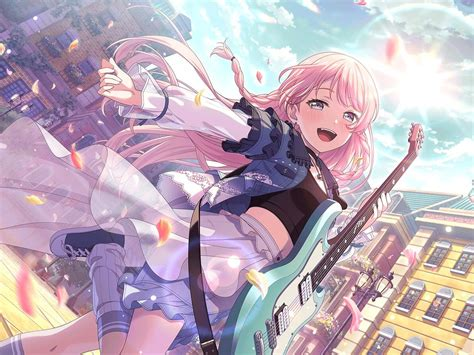

<table>
<tr>
<td width="45%">

</td>
<td width="55%" align="center">

 

**AI · Code · Algorithms**

<i>Keep learning, keep building.</i>

</td>
</tr>
</table>

 

<h2 align="center">✧ About Me ✧</h2>

不知名计算机科学专业在读学生

AI 全栈开发 / AI Agent / 算法爱好者

喜欢健身、文学、游戏、音乐与二次元

 

 

<h2 align="center">✧ Tech Stack ✧</h2>

  

